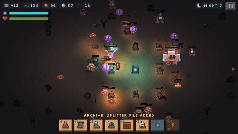
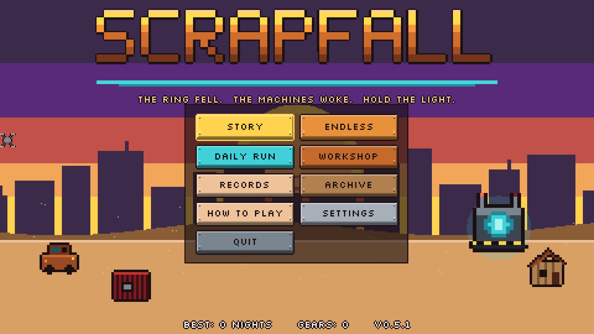
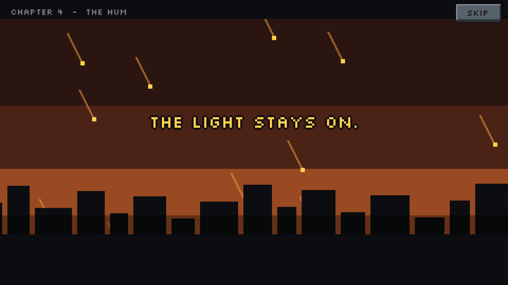
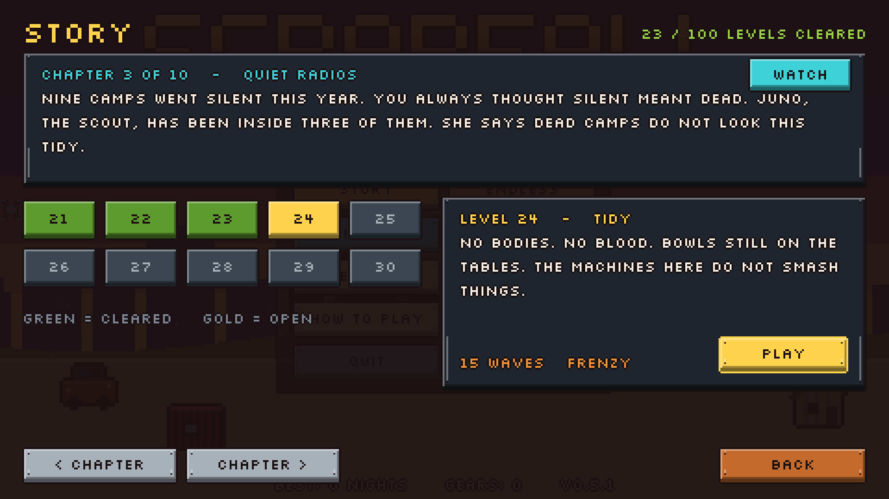
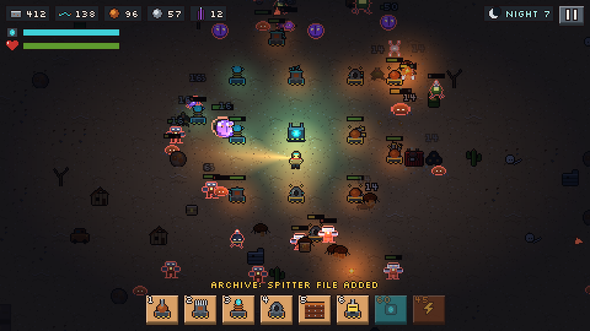
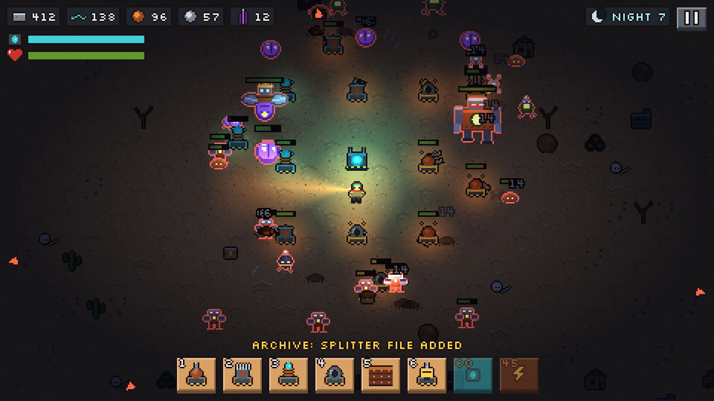
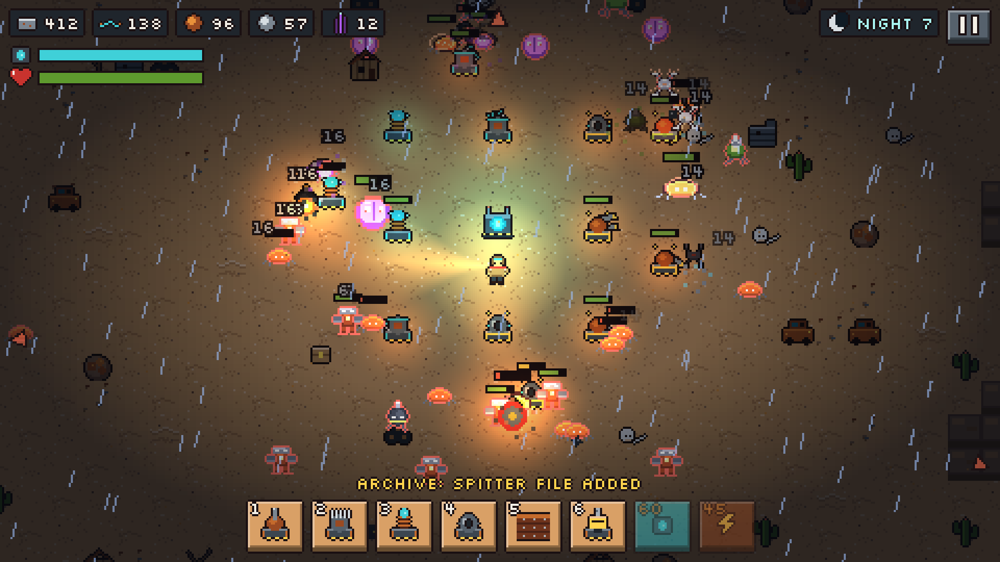

# SCRAPFALL

**The ring fell. The machines woke. Hold the light.**

A pixel survival tower-defense game for Android and Windows. Scavenge the wasteland by day, defend your generator core by night, and fight through a 100-level story about what happens after the machines that built the world fall out of the sky.

**[Download the latest version](../../releases/latest)** · free · no ads · plays offline

## What's in it

- **Story mode** - 100 levels in 10 chapters, each with 15 or more waves, bosses on every fifth level, and animated cutscenes that open and close every chapter.
- **Endless mode** - day and night cycles that never stop getting worse, with four difficulty settings and a Daily Run that gives everyone the same map.
- **Ten buildings** - guns with barrels that track their targets, tesla coils, mortars, flamethrowers, snipers, walls, drills, and support towers that slow machines or repair your base.
- **Eight kinds of machine and three bosses** - crawlers, drones, brutes, splitters, bombers, spitters, elites, the Grinder, the Carrion Queen and the Foundry.
- **Weather** - dust storms that cut what you can see in half, and thunderstorm nights that are pitch black until the lightning hits.
- **Things to keep** - permanent workshop upgrades, 12 achievements, lifetime records, and an Archive of data logs and machine files to uncover.

| | | |
|---|---|---|
|  |  |  |
|  |  |  |

## Download

Go to **[Releases](../../releases/latest)** and pick:

- **Android:** the `.apk` file - open it on your phone and install (allow "Install unknown apps" for your browser if asked). Play in landscape.
- **Windows:** the `.exe` file - download and double-click. No install needed.

The game checks for updates from its menu. When a new version is out it shows what's new and lets you update now or later; your progress is saved and carries over.

## How to play

| | PC | Phone |
|---|---|---|
| Move | WASD | left side of the screen |
| Aim + shoot | mouse + left click | right side of the screen |
| Scavenge / mine | hold E near a wreck or ore | hold the hand button |
| Build | 1-6, click to place | hammer button, then tap the map |
| Upgrade / repair | U / R on a building | arrow / wrench next to a building |
| Core shield / overcharge towers | H / O | buttons in the build bar |
| Pause | Esc or P | top-right button or the back button |

Bring loot back to your core to bank it. Drills mine ore for you. Each dawn (or every fifth wave in story mode) you pick one upgrade for the run.

## About

Made by PRiNXCYS with Godot 4. The art, sound effects and music are all generated by code. Feedback and bug reports are welcome in [Issues](../../issues).

Join the community on [Discord](https://discord.gg/myNGtrqqB).
